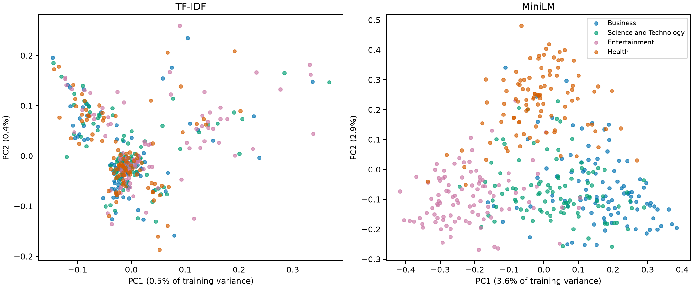

# News headline embedding visualiser

Do sentence embeddings predict the topic of an unseen news headline more accurately than TF-IDF when both use the topic of the most similar training headline?

## Data

I sample 500 distinct stories from each of four topics in the 2014 UCI News Aggregator collection. I retain one headline per story and remove repeated headline text before splitting. The notebook uses public headlines and processes them locally.

Source and attribution: Fabio Gasparetti, *News Aggregator*, UCI Machine Learning Repository, [dataset and download](https://doi.org/10.24432/C5F61C), [CC BY 4.0](https://creativecommons.org/licenses/by/4.0/). The processed CSV is a cleaned, balanced subset.

## Method

I compare TF-IDF and [MiniLM sentence embeddings](https://huggingface.co/sentence-transformers/all-MiniLM-L6-v2) with the same cosine nearest-neighbour rule. I use five stratified folds on 1,600 training headlines and reserve 400 for the final test. Each TF-IDF vocabulary is fit on the reference headlines for that fold. The model uses full vectors for prediction. Separate PCA plots project the same test headlines onto two axes learned from training.

## Results and interpretation

| Method | Mean five-fold accuracy | Held-out accuracy | Held-out macro-F1 |
|---|---:|---:|---:|
| TF-IDF | 63.88% | 64.75% | 0.649 |
| MiniLM | 81.63% | 83.25% | 0.833 |

MiniLM correctly assigned topics to 333 of 400 unseen headlines. TF-IDF correctly assigned 259. MiniLM therefore classified 74 additional headlines correctly, a gain of 18.50 percentage points on this test set.

The HP and Audi errors illustrate how a shared company name can connect headlines from different topics. MiniLM also confused two CBS stories about performers and earnings.

See `results/model_scores.csv` for each fold, the fold averages and the held-out scores. See `results/pca_comparison.png` for the two projections. Each colour is a known topic. Review `results/error_analysis.csv` by comparing each headline with its nearest training headline. The notebook preserves explanations for matching cases on rerun.

## Limitations

The sample gives equal weight to four topics in one historical collection. Real news feeds can have different topic proportions. Headlines provide little context, and one story may fit more than one topic. A two-dimensional projection loses information. Differences in plot position across panels have no common scale or interpretation.

## Run the notebook in Miniconda

1. Download the original dataset using the UCI link above. Extract the archive and place `newsCorpora.csv` in `data/raw/`.
2. Open Jupyter from Miniconda and open `embedding_visualiser.ipynb` in the project folder.
3. For a fresh installation, use a Python 3.12 kernel with the supplied package versions. Run `%pip install -r requirements.txt` in a notebook cell, then restart the kernel. If the notebook already runs in your Miniconda environment, continue to the next step.
4. Select **Run All Cells** and save the notebook. The first run downloads the pretrained MiniLM model. The notebook writes the balanced sample to `data/processed/headlines_sample.csv` and the scores, PCA plot and ten reviewed prediction errors to `results/`.
